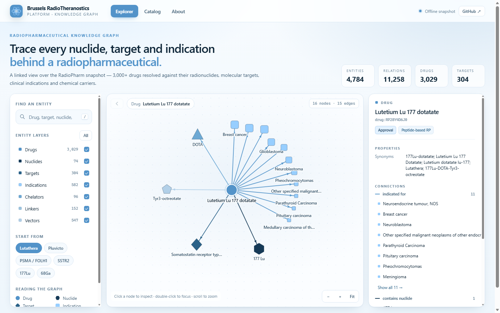

# Brussels RadioTheranostics Platform — Knowledge Graph

A static, dependency-free knowledge graph of radiopharmaceuticals: **4,784 entities** and
**11,258 typed relations** linking drugs to their radionuclides, molecular targets, clinical
indications, chelators, linkers and vectors.

Built from the offline **RadioPharm** Markdown snapshot (IDRlab), with every transformation
written down and reproducible.



---

## What is in the graph

| Entity | Nodes | What it represents |
| --- | ---: | --- |
| Drug | 3,029 | Radiopharmaceuticals (compound, peptide, antibody, element, microsphere) |
| Indication | 582 | Clinical indications, with ICD-11 code and phase on the edge |
| Vector | 547 | Targeting vectors |
| Target | 304 | Molecular targets (gene symbol, UniProt, function) |
| Linker | 152 | Linkers |
| Chelator | 96 | Chelators (formula, PubChem CID) |
| Nuclide | 74 | Radionuclides (half-life, decay, radiation, range) |

| Relation | Edges | Direction |
| --- | ---: | --- |
| `CONTAINS_NUCLIDE` | 3,029 | Drug → Nuclide |
| `INDICATED_FOR` | 3,537 | Drug → Indication |
| `TARGETS` | 2,223 | Drug → Target |
| `USES_VECTOR` | 1,007 | Drug → Vector |
| `USES_CHELATOR` | 962 | Drug → Chelator |
| `USES_LINKER` | 500 | Drug → Linker |

Every indication edge also carries `application` (Treatment / Diagnosis), `phase` and `ICD-11`
code, so clinical status is queryable without leaving the graph.

## Explore

```bash
# any static server works
python -m http.server 8080
# open http://127.0.0.1:8080
```

* **Explorer** — start from Lutathera, Pluvicto, PSMA/FOLH1, SSTR2, ¹⁷⁷Lu or ⁶⁸Ga, or search
  the full index. Click a node to inspect it, double-click to re-centre the neighbourhood.
  Deep links: `/?focus=drug:RP28Y4D6J0`.
* **Catalog** — all 3,029 drugs with nuclide, highest phase, target and indication counts.
* **About** — provenance, schema and the data-quality notes.

## Repository layout

```
index.html                 single-page app (Explorer / Catalog / About)
assets/css/app.css         design system, three-blue palette
assets/js/app.js           data loading, radial layout, canvas renderer, UI
data/kg.json               the graph (nodes + edges, compact JSON)
tools/build_kg.py          Markdown snapshot → data/kg.json
tools/.cache/              cached API back-fill responses (git-ignored)
docs/DATA.md               schema, build flags, known limitations
docs/preview.png           screenshot
```

## Rebuilding the graph

```bash
python tools/build_kg.py --kb "path/to/RadioPharm知识库-MD" --out data/kg.json
```

Add `--enrich` to complete the five chelator pages whose drug list is truncated at 50 entries.
The back-fill hits the same public RadioPharm endpoint the snapshot was exported from and caches
each response under `tools/.cache/`; rebuilds then run offline.

The builder is standard-library only (Python 3.10+). `--stats-only` prints counts without
writing a file.

## Deploy

The site is plain static files; there is no build step. On GitHub open
**Settings → Pages → Build and deployment → Deploy from a branch → `main` / `/ (root)`**.
The explorer is then served at `https://<user>.github.io/Brussels-RadioTheranostics-Platform/`.

Any static host works the same way — the only requirement is that `index.html`, `assets/`
and `data/` are served from the same origin.

## Design

The interface uses three blues and nothing else:

| Token | Hex | Use |
| --- | --- | --- |
| wash | `#b2d0e8` | surfaces, quiet nodes, vector layer |
| signal | `#97ceff` | highlights, indications, focus glow |
| anchor | `#5293c9` | primary actions, drugs, links |

Node types are additionally encoded by shape (circle, hexagon, diamond, square, triangle,
pentagon), so the graph stays readable without relying on hue alone.

## Data quality

Honest limitations, also surfaced in the app's **About** page:

* **488 indication nodes** are *inline*: the snapshot has no page for them, so they are created
  from the indication rows on drug pages and flagged `x: 1`.
* **5 chelator pages** truncate their drug list at 50 entries; `--enrich` restores the missing
  **424 links**.
* **3 drug IDs** were recovered from the catalog CSV (their page header lost the ID line).
* **3 references** could not be resolved to a catalogued entity and were dropped rather than
  invented.
* Two drugs with no resolvable relation are pruned from the rendered graph.

## Attribution

Data: [RadioPharm](https://radiopharm.idrblab.cn), IDRlab.
Please cite the RadioPharm paper when reusing the underlying data.
Code in this repository is released under the MIT licence.
